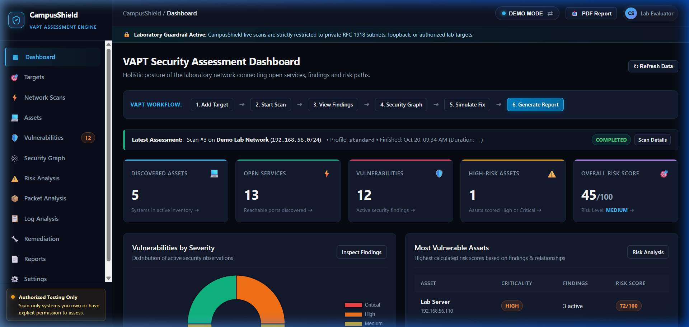
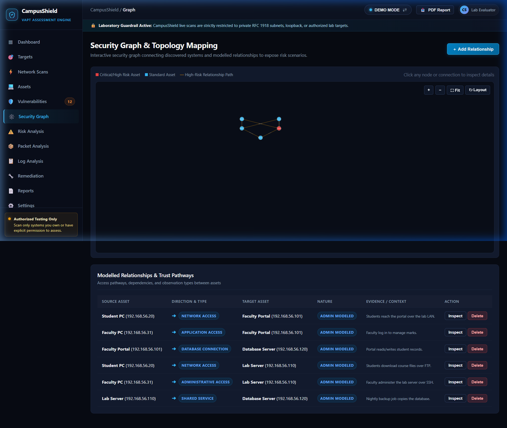
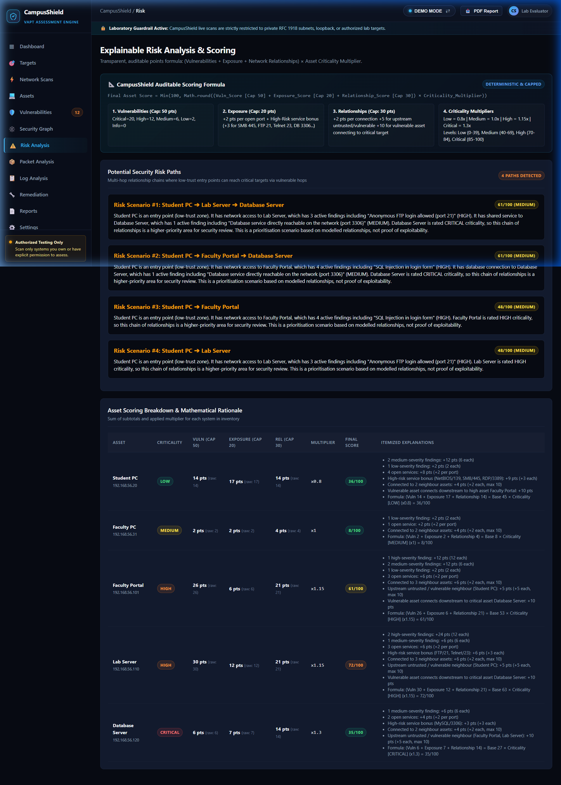
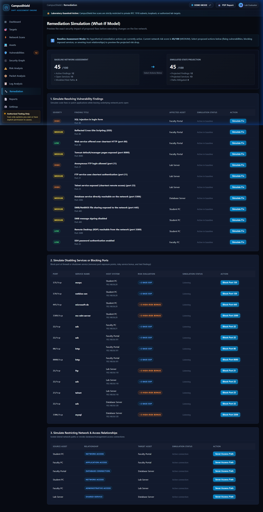
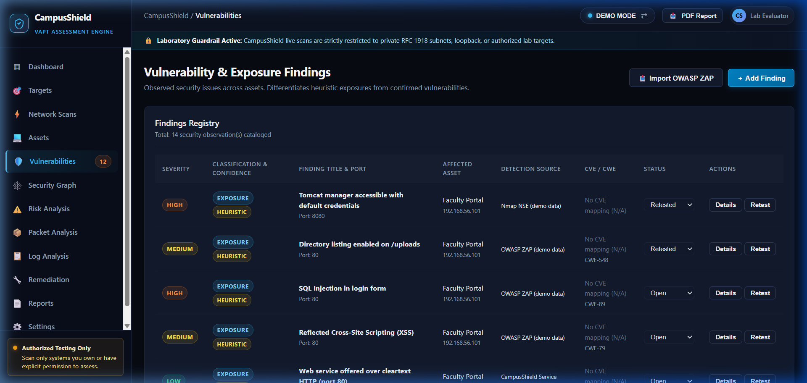
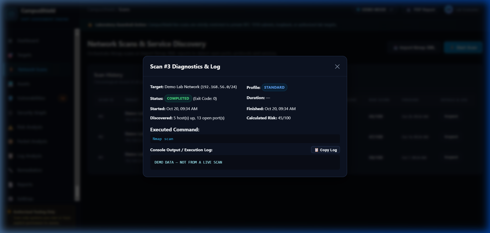
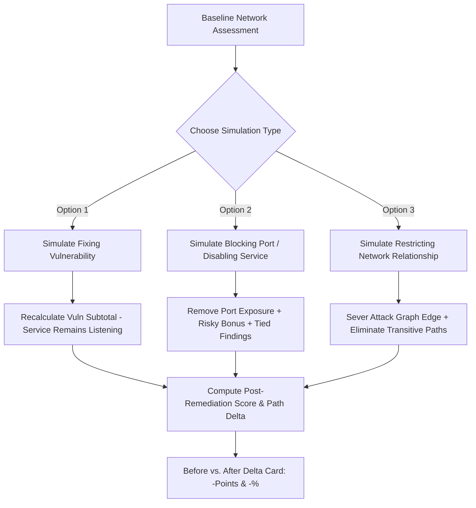

# CampusShield 🛡️
### *Graph-Based Attack-Surface & Trust-Relationship Risk Assessment Platform*

<p align="center">
  
</p>

<p align="center">
  <strong>Contextual VAPT & Lateral Movement Risk Engine for Educational Networks and Cybersecurity Laboratories</strong>
</p>

<p align="center">
  <a href="https://github.com/immortalfoodie/CampusShield/actions"></a>
  <a href="#-tech-stack"></a>
  <a href="#-data-layer"></a>
  <a href="#-security-graph--topology-mapping"></a>
  <a href="#license"></a>
</p>

---

## 📑 Table of Contents

- [Overview](#-overview)
- [Key Innovations & Distinctions](#-key-innovations--distinctions)
- [Visual Interface Tour](#-visual-interface-tour)
- [System Architecture](#-system-architecture)
- [Mathematical Risk Scoring Engine](#-mathematical-risk-scoring-engine)
- [What-If Remediation Simulation](#-what-if-remediation-simulation)
- [Safe Laboratory Scope Guard](#-safe-laboratory-scope-guard)
- [Getting Started](#-getting-started)
- [Step-by-Step Viva & Defense Protocol](#-step-by-step-viva--defense-protocol)
- [Technical Stack & Dependencies](#-technical-stack--dependencies)
- [Directory Structure](#-directory-structure)
- [API Reference](#-api-reference)
- [Automated Verification & Testing](#-automated-verification--testing)
- [Disclaimer & Ethical Boundary](#-disclaimer--ethical-boundary)

---

## 🌟 Overview

**CampusShield** is an educational, graph-based Vulnerability Assessment and Penetration Testing (VAPT) and lateral-movement risk analysis platform built for college laboratory networks.

Traditional vulnerability scanners operate on a naive model:
$$\text{Scan IP} \longrightarrow \text{Detect Open Ports} \longrightarrow \text{List Unsorted CVEs}$$

CampusShield introduces **relational risk contextualization**:
$$\text{Scan \& Discover} \longrightarrow \text{Classify Findings} \longrightarrow \text{Map Graph Topology} \longrightarrow \text{Trace Risk Paths} \longrightarrow \text{Simulate What-If Remediation} \longrightarrow \text{Audit-Ready PDF}$$

It evaluates security weaknesses not in isolation, but in the context of **network connections**, **access privileges**, **service exposure**, and **asset criticality**, allowing security analysts and students to prioritize the exact multi-hop pathways an attacker could traverse to compromise critical laboratory infrastructure.

---

## 💡 Key Innovations & Distinctions

| Capability | Traditional Student Tool | CampusShield Platform |
|---|---|---|
| **Vulnerability Analysis** | Raw CVSS scores without network context | **Tri-Factor Model:** Vulnerabilities + Network Exposure + Relational Topology multiplied by Asset Criticality. |
| **Heuristic vs. Exploits** | Fabricates CVEs from mere listening ports | **Strict Tri-Tier Separation:** Distinguishes observed network exposure, rule-based heuristics, and evidence-backed vulnerabilities. |
| **Attack Paths** | Fabricates arbitrary arrows or lists | **Deterministic Graph Traversal:** Identifies multi-hop chains traversing from untrusted entry points to critical assets. Zero fabrication on single-host scans. |
| **Remediation Modeling** | Static checklists or post-remediation re-scans | **What-If Simulation Engine:** Dynamically previews risk score reduction for fixing vulnerabilities, blocking exposed ports, or severing relationships. |
| **Laboratory Safety** | Open scanning capable of targeting public IPs | **Scope Guardrails:** Restricts scans strictly to RFC 1918 private IPv4, IPv6 loopback (`::1`), link-local (`fe80::/10`), ULAs, and small subnets ($\le /24$) with DNS rebinding protection. |
| **Environment Separation** | Shared database risking demo destruction | **Dual Database Architecture:** Completely isolated storage between `data/demo.db` (5-asset campus network) and `data/live.db` (live authorized scans). |
| **Reporting** | Basic HTML printouts | **Executive & Technical PDF Report:** Multi-page PDF generator covering all 20 audit specification sections with verified tables, rationale, and charts. |

---

## 🖥️ Visual Interface Tour

<p align="center">
  
  <em><strong>Figure 1: Executive Security Dashboard</strong> — High-level KPI cards, recent scan telemetry banner, severity breakdown doughnut chart, and quick-action shortcuts.</em>
</p>

<br />

<p align="center">
  
  <em><strong>Figure 2: Interactive Relational Security Graph</strong> — Force-directed network topology canvas modeling host nodes, multi-hop access paths, trust relationships, and transitive risk propagation.</em>
</p>

<br />

<p align="center">
  
  <em><strong>Figure 3: Auditable Mathematical Risk Analysis</strong> — Transparent risk breakdown showing live calculation formula, factor subtotals, zero-path context explanations, and prioritized remediation actions.</em>
</p>

<br />

<p align="center">
  
  <em><strong>Figure 4: Non-Destructive What-If Remediation Simulator</strong> — Side-by-side Before vs. After risk modeling for code vulnerabilities, port/service blocking, and network isolation with exact percentage reductions.</em>
</p>

<br />

<p align="center">
  
  <em><strong>Figure 5: Tri-Tier Findings Ledger</strong> — Strict classification distinguishing network exposures, hardening checks, and proven vulnerabilities with full lifecycle tracking (Open &rarr; Fixed).</em>
</p>

<br />

<p align="center">
  
  <em><strong>Figure 6: Live Scan Execution Diagnostics</strong> — Transparent modal displaying exact Nmap CLI syntax, exit code (0), elapsed runtime in milliseconds, and raw process output stream.</em>
</p>

---

## 🏛️ System Architecture

CampusShield is built on a modular 5-layer decoupled architecture:

```
┌────────────────────────────────────────────────────────────────────────┐
│                        1. PRESENTATION LAYER                           │
│   Single Page Application (SPA)  •  Vanilla CSS Dark Cyber Theme       │
│   Cytoscape.js Security Graph    •  Chart.js Severity Metrics          │
│   Hash Router (#scans, #assets, #vulnerabilities, #graph, #remediation)│
└───────────────────────────────────┬────────────────────────────────────┘
                                    │ REST API JSON
┌───────────────────────────────────▼────────────────────────────────────┐
│                          2. ANALYSIS LAYER                             │
│   Auditable Risk Engine          •  What-If Scenario Simulator         │
│   Attack-Path Graph Traversal    •  Action Prioritization Matrix       │
└───────────────────────────────────┬────────────────────────────────────┘
                                    │
┌───────────────────────────────────▼────────────────────────────────────┐
│                          3. SECURITY LAYER                             │
│   Subprocess Nmap Integration    •  Structured XML Parser              │
│   Safe Web Baseline Prober       •  Offline PCAP Frame Analyzer        │
│   SSH / Auth Log Pattern Engine  •  Scope Guard & DNS Rebinding Check  │
└───────────────────────────────────┬────────────────────────────────────┘
                                    │
┌───────────────────────────────────▼────────────────────────────────────┐
│                           4. DATA LAYER                                │
│   Node.js Native SQLite (node:sqlite DatabaseSync)                     │
│   data/demo.db (Simulated 5-Node)  |  data/live.db (Authorized Scans) │
│   Runtime Schema Migrations        |  Snapshot Versioning              │
└───────────────────────────────────┬────────────────────────────────────┘
                                    │
┌───────────────────────────────────▼────────────────────────────────────┐
│                    5. CONTROLLED LAB ENVIRONMENT                       │
│   Localhost Loopback (127.0.0.1) •  Authorized Lab Subnets (RFC 1918) │
│   Course Virtual Machines        •  DVWA / Metasploitable Targets      │
└────────────────────────────────────────────────────────────────────────┘
```

---

## 📐 Mathematical Risk Scoring Engine

Unlike proprietary black-box scanners, CampusShield calculates asset risk scores using a **deterministic, bounded, and mathematically explainable formula**:

$$\text{Final Asset Score} = \min\left(100, \; \text{round}\Big(\big(\text{VulnScore} + \text{ExposureScore} + \text{RelationshipRisk}\big) \times \text{CriticalityMultiplier}\Big)\right)$$

### 1. Factor Subtotals & Category Bounds

```
├── 1. Vulnerability Subtotal (Capped at 50 Points)
│   ├── Critical Severity Finding : +20 pts each
│   ├── High Severity Finding     : +12 pts each
│   ├── Medium Severity Finding   : +6 pts each
│   ├── Low Severity Finding      : +2 pts each
│   └── Info / Informational      : +0 pts
│
├── 2. Network Exposure Subtotal (Capped at 20 Points)
│   ├── Open Reachable Port       : +2 pts per discovered TCP/UDP service
│   └── High-Risk Port Bonus      : +3 pts each for high-exposure services
│       (SMB/445, FTP/21, Telnet/23, RDP/3389, MySQL/3306, Postgres/5432, MSSQL/1433, Redis/6379)
│
├── 3. Relationship & Topology Risk (Capped at 30 Points)
│   ├── Neighbor Connectivity    : +2 pts per connected neighbor asset (max 10 pts)
│   ├── Untrusted Upstream Hop   : +5 pts if connected from an entry-point / vulnerable node (max 10 pts)
│   └── Downstream Critical Reach: +10 pts if this vulnerable host connects to a High/Critical target
│
└── 4. Asset Criticality Multipliers
    ├── Low Criticality Asset     : × 0.8
    ├── Medium Criticality Asset  : × 1.0
    ├── High Criticality Asset    : × 1.15
    └── Critical Infrastructure   : × 1.3
```

### Risk Category Thresholds

| Score Range | Category | Color Coding | Recommended Operational SLA |
|---|---|---|---|
| **85 – 100** | **Critical** | 🔴 Crimson (`#ef4444`) | Immediate remediation; isolate host from core lab network. |
| **70 – 84** | **High** | 🟠 Orange (`#f97316`) | Remediation required within 24 hours; restrict ingress connections. |
| **40 – 69** | **Medium** | 🟡 Amber (`#eab308`) | Hardening plan scheduled in course lab sprint. |
| **0 – 39** | **Low** | 🟢 Emerald (`#10b981`) | Acceptable baseline; routine monitoring. |

---

## 🔬 What-If Remediation Simulation

CampusShield features a non-destructive **Scenario Simulation Engine**. Analysts can preview risk reductions across assets and attack paths *before* changing real configurations or deploying patches:



### Distinguishing Service Blocking vs. Code Patching

- **Simulating Finding Resolution:** Resolves the vulnerability code (e.g., patching an SMB flaw), dropping the vulnerability points while leaving the port open for exposure scoring.
- **Simulating Port Blocking:** Models firewall rules or service termination (e.g., blocking TCP port 445). This removes the open port points (+2), the high-risk service bonus (+3), and any finding tied to that port (+6), yielding an auditable **11-point reduction**.

---

## 🔒 Safe Laboratory Scope Guard

To preserve its mission as an educational defense platform, CampusShield enforces strict scope validation:

1. **Allowed Targets:**
   - IPv4 Loopback: `127.0.0.1` and `127.0.0.0/8`
   - IPv6 Loopback: `::1`
   - Private RFC 1918 IPv4: `10.0.0.0/8`, `172.16.0.0/12`, `192.168.0.0/16`
   - IPv6 Link-Local: `fe80::/10`
   - IPv6 Unique Local Addresses (ULA): `fc00::/7`
   - Bounded Laboratory Subnets: CIDRs $\le /24$ (e.g., `/24`, `/28`, `/30`)
2. **Blocked Targets:**
   - All Public Internet IPv4 (e.g., `8.8.8.8`, `1.1.1.1`) and IPv6 addresses.
   - Large IP blocks ($> /24$, such as `/16` or `/8`) to prevent disruptive network sweeps.
   - Multicast, broadcast, and invalid formats.
3. **DNS Rebinding Guard:** Hostnames are resolved to concrete IP addresses prior to validation, ensuring the exact validated IP is passed to scanner subprocesses.

---

## ⚡ Getting Started

### Prerequisites

- **Node.js 22.13.0 or higher** (uses built-in `node:sqlite` DatabaseSync module)
- **Nmap 7.90+** *(optional for live scanning; Demo Mode runs without Nmap)*

### Installation & Launch

```powershell
# 1. Clone the repository
git clone https://github.com/immortalfoodie/CampusShield.git
cd CampusShield

# 2. Install production and dev dependencies
npm install

# 3. Generate sample PCAP and authentication logs
npm run samples

# 4. Execute the comprehensive test suite
npm test

# 5. Start the CampusShield local server
npm start
```

Open your web browser and navigate to:
👉 **`http://127.0.0.1:4173`** *(CampusShield binds strictly to loopback for security)*

---

## 🎓 Step-by-Step Viva & Defense Protocol

When demonstrating CampusShield to evaluators, instructors, or external examiners, follow this 7-step presentation flow:

```
  [1] Scope Guard Enforcement
         │  Try adding 8.8.8.8 -> Demonstrate instant rejection
         ▼
  [2] Discovery Scans & Execution Traceability
         │  Run Quick Discovery -> Inspect command, duration (s) & exit code (0)
         ▼
  [3] Heuristic Exposure vs. Confirmed Exploits
         │  Inspect Port 445 -> Badge: "Exposure", Confidence: "Heuristic", No CVE
         ▼
  [4] Auditable Mathematical Scoring
         │  Show 17/100 Breakdown: Vuln (6) + Exposure (11) + Rel (0) = 17 × 1.0
         ▼
  [5] Topology Mapping & Path Traversal
         │  Live Mode (1 Node, Zero Paths) vs. Demo Mode (5 Nodes, 4 Risk Paths)
         ▼
  [6] Non-Destructive What-If Remediation
         │  Block Port 445 -> Score drops 17 -> 6 (-11 pts, -65%) -> Reset simulation
         ▼
  [7] Audit-Ready PDF Generation
            Download 6-section report covering all 20 syllabus specifications
```

---

## 🛠️ Technical Stack & Dependencies

| Layer | Technology | Purpose |
|---|---|---|
| **Runtime** | **Node.js (ES Modules)** | Server-side execution using modern native ECMAScript modules. |
| **Database** | **`node:sqlite` (`DatabaseSync`)** | Built-in zero-dependency relational database engine; eliminates external SQLite binary compilation issues. |
| **Web Server** | **Express 4.22** | Clean REST API routing, streaming scan progress, and static file delivery. |
| **Security Graph** | **Cytoscape.js 3.34** | Graph theory visualization, layout optimization, and interactive topology exploration. |
| **Data Viz** | **Chart.js 4.5** | Doughnut charts for vulnerability severity distributions and trend analysis. |
| **PDF Engine** | **PDFKit 0.20** | Multi-page PDF report generation with vector styling, headers, tables, and page numbering. |
| **Discovery** | **Nmap 7.9x Subprocess** | Safe unprivileged TCP connect discovery (`-sT`), service banners (`-sV`), and NSE script outputs. |
| **Parsing** | **fast-xml-parser 5.11** | High-performance streaming conversion of Nmap XML outputs into structured asset records. |

---

## 📁 Directory Structure

```
CampusShield/
├── .gitignore                  # Ignores databases, node_modules, and raw logs
├── README.md                   # Comprehensive repository documentation
├── package.json                # Project dependencies and operational scripts
├── package-lock.json           # Deterministic dependency tree
│
├── public/                     # Presentation Layer (Client Application)
│   ├── app.js                  # Modular SPA logic, hash router, modals, API client
│   ├── index.html              # Modern dark-theme shell with accessible semantics
│   ├── styles.css              # Curated cyber dark-mode design system & animations
│   └── favicon.svg             # Vector shield emblem
│
├── samples/                    # Offline Analysis Test Fixtures
│   ├── sample_access.log       # Web server access log with traversal attempts
│   ├── sample_auth.log         # SSH authentication log with brute-force patterns
│   └── sample_capture.pcap     # Network packet capture containing HTTP & FTP flows
│
├── scripts/                    # Automation & Testing Tools
│   ├── make-samples.js         # Generator for deterministic test logs and PCAPs
│   └── smoke-test.js           # 64-test automated test and regression suite
│
├── server/                     # Backend Application & Services
│   ├── db.js                   # Dual SQLite connection manager & schema migrations
│   ├── index.js                # Server entry point bound to 127.0.0.1:4173
│   ├── routes/
│   │   └── api.js              # REST endpoints for state, scans, graph & reports
│   └── services/
│       ├── checks.js           # Rule engine, NSE parser & safe web baseline checks
│       ├── demo.js             # Deterministic 5-asset college lab network seeder
│       ├── log.js              # Offline log parser for SSH and HTTP anomaly clusters
│       ├── nmap.js             # Safe Nmap subprocess runner and XML parser
│       ├── pcap.js             # Pure JavaScript PCAP/PCAPNG packet parser
│       ├── report.js           # 20-section audit-ready PDF report generator
│       ├── risk.js             # Auditable scoring formulas, caps & attack-path traversal
│       ├── scanner.js          # Scan lifecycle coordinator and retest runner
│       ├── scope.js            # Laboratory scope guard (RFC 1918, IPv6, CIDR)
│       └── workspace.js        # State aggregator and snapshot management
│
└── legacy_v1/                  # Historical project archive (preserved for reference)
```

---

## 🔌 API Reference

| Method | Endpoint | Description |
|---|---|---|
| `GET` | `/api/state` | Returns global state: active mode, inventory, scans, baseline scores, and recommendations. |
| `POST` | `/api/mode` | Switches active workspace mode between `demo` and `live`. |
| `GET` | `/api/targets` | Lists all authorized laboratory targets. |
| `POST` | `/api/targets` | Validates target against the scope guard and registers an authorized host/subnet. |
| `POST` | `/api/scans` | Initiates an Nmap scan (`quick`, `standard`, or `vuln`) in the background. |
| `GET` | `/api/scans/:id` | Polls scan execution status, progress percentage, duration, and console logs. |
| `POST` | `/api/scans/:id/cancel` | Gracefully cancels an active scan subprocess. |
| `GET` | `/api/findings` | Retrieves all discovered security findings across assets. |
| `PATCH` | `/api/findings/:id/status`| Advances finding lifecycle (`open` $\rightarrow$ `under_review` $\rightarrow$ `planned` $\rightarrow$ `fixed` $\rightarrow$ `retested`). |
| `POST` | `/api/findings/:id/retest`| Executes a targeted single-port probe to verify finding remediation. |
| `GET` | `/api/relationships` | Returns all modeled and observed network connections between assets. |
| `POST` | `/api/relationships` | Creates an access pathway with direction, nature, and supporting evidence. |
| `GET` | `/api/risk` | Calculates baseline model, simulated model, attack paths, and recommendations. |
| `POST` | `/api/simulation/toggle` | Toggles What-If status for a finding, service/port closure, or relationship. |
| `POST` | `/api/simulation/clear` | Clears all active simulation items and restores the baseline model. |
| `POST` | `/api/analyze-pcap` | Parses an uploaded base64 `.pcap` capture and identifies unencrypted protocols. |
| `POST` | `/api/analyze-log` | Parses uploaded `.log` content for failed SSH logins and web anomalies. |
| `GET` | `/api/report.pdf` | Generates and downloads a multi-page executive/technical PDF report. |

---

## 🧪 Automated Verification & Testing

CampusShield includes a comprehensive regression test suite covering all functional layers. Run it with:

```powershell
npm test
```

### Verified Test Areas (64/64 Passing)

- **[1] Data Layer & Seeding:** Deterministic 5-asset network seeding with assets, services, findings, and relationships.
- **[2] Demo vs. Live Data Isolation:** Confirms that records written to `live.db` are strictly invisible in `demo.db`.
- **[3] Scope Guard:** Loopback (`127.0.0.1`, `localhost`, `::1`), link-local (`fe80::1`), ULA (`fc00::1`), RFC 1918 subnets, and rejection of public IPs (`8.8.8.8`, `1.1.1.1`).
- **[4] Nmap Integration:** Verifies `--top-ports 100` for Quick Discovery, `--top-ports 1000` for Standard Assessment, and structured XML extraction.
- **[5] Findings Classification:** Validates that port 445 is classified as `exposure` with `heuristic` confidence and `cve: null`.
- **[6] Scoring Formula Regression:** Proves that the 17-point localhost scenario ($6 \text{ vuln} + 11 \text{ exposure} = 17 \text{ pts}$) is mathematically verified and bounded by category caps.
- **[7] Security Graph & Paths:** Multi-hop path identification on connected graphs; validates that single-host scans produce 0 fabricated paths.
- **[8] What-If Simulation:** Confirms that fixing findings reduces score (-6 pts), blocking port 445 drops score (-11 pts), and raw baseline data remains immutable.
- **[9] Offline Captures:** Validates HTTP/FTP unencrypted detection in PCAP and SSH brute-force detection in logs.
- **[10] PDF Report Generation:** Ensures the PDF generator produces valid `%PDF-` output matching active database records.

---

## ⚖️ Disclaimer & Ethical Boundary

> [!IMPORTANT]
> **Educational & Authorized Laboratory Use Only:**
> CampusShield is designed strictly for academic instruction, laboratory exercises, and authorized penetration testing evaluations.
> - The software enforces technical guardrails preventing scans against unauthorized public IP addresses.
> - Users are strictly responsible for ensuring explicit written authorization from network owners before initiating network scans or vulnerability assessments on any system.
> - The creators and contributors assume no liability for misuse or damage caused by this software.

---

<p align="center">
  <strong>CampusShield</strong> • Developed for Network Security & VAPT Laboratory Education • 2026
</p>
